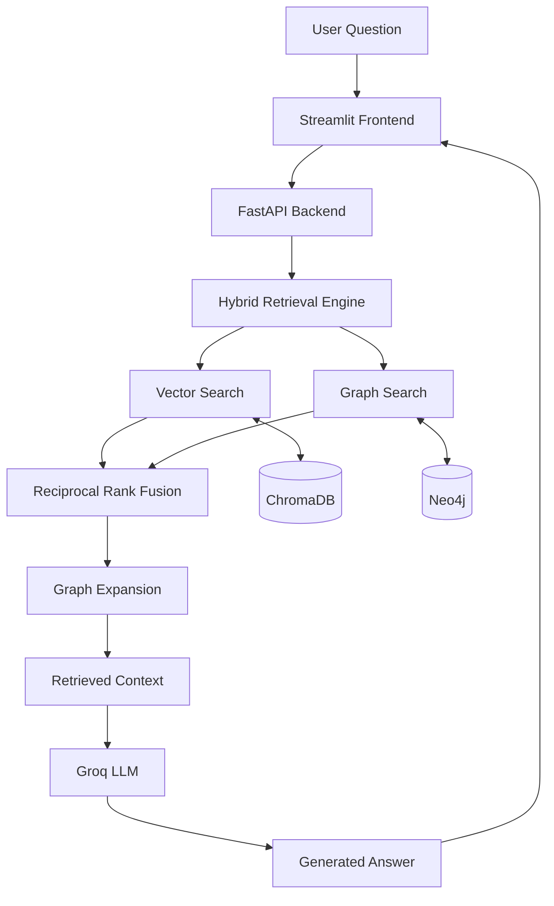

# 🚀 VentureLens – Hybrid GraphRAG System

**An AI-powered intelligent information retrieval system combining Vector Search, Knowledge Graphs, and Large Language Models.**

VentureLens is a Hybrid GraphRAG application designed to retrieve, connect, and generate meaningful insights from structured and unstructured information.

Instead of relying only on traditional semantic search, VentureLens combines vector-based retrieval with graph-based retrieval to provide more contextual and relationship-aware answers.

---

## 🎯 Project Overview

Traditional Retrieval-Augmented Generation (RAG) systems mainly rely on vector similarity to retrieve relevant information.

VentureLens takes this further by combining:

- **Vector Search:** Finds semantically similar information.
- **Graph Search:** Discovers relationships between entities.
- **Hybrid Retrieval:** Combines results from both retrieval approaches.
- **Reciprocal Rank Fusion (RRF):** Merges and ranks retrieved results.
- **Graph Expansion:** Retrieves additional context through connected graph entities.
- **LLM Generation:** Generates natural-language answers based on retrieved context.

The goal is to provide more informative and context-aware answers by leveraging both semantic similarity and entity relationships.

## 🏗️ System Architecture



## ⚙️ Technologies Used

| Technology | Purpose |
|---|---|
| Python | Core development |
| FastAPI | Backend API |
| Streamlit | Interactive frontend |
| ChromaDB | Vector database |
| Neo4j | Knowledge graph database |
| Sentence Transformers | Text embeddings |
| Groq API | LLM inference |
| Railway | Cloud deployment |
| Reciprocal Rank Fusion | Hybrid result ranking |

## ✨ Key Features

### 1. Vector Retrieval
Uses text embeddings to retrieve relevant documents based on semantic similarity.

### 2. Graph Retrieval
Uses Neo4j to explore relationships between entities and retrieve connected information.

### 3. Hybrid Retrieval
Combines vector and graph retrieval results to improve the relevance and contextual coverage of retrieved information.

### 4. Reciprocal Rank Fusion (RRF)
Combines ranked results from different retrieval methods into a unified ranking.

### 5. Graph Expansion
Expands retrieved results by exploring related entities and relationships in the knowledge graph.

### 6. AI-Powered Question Answering
Uses an LLM to generate responses based on the retrieved information.

## 📁 Project Structure

```text
VentureLens-Hybrid-GraphRAG/
│
├── api/
│   └── main.py
│
├── app/
│   └── streamlit_app.py
│
├── src/
│   ├── embedding_builder.py
│   ├── graph_builder.py
│   ├── graph_retrieval.py
│   ├── hybrid_retrieval.py
│   ├── vector_search.py
│   └── test_connection.py
│
├── data/
│
├── chroma_db/
│
├── requirements.txt
├── .python-version
└── README.md
```

*Note: The structure above highlights the main project components.*

## 🚀 Getting Started

### Prerequisites

Make sure you have:

- Python 3.11.8
- Neo4j database
- Groq API credentials
- Required project data and vector database

### 1. Clone the Repository

```bash
git clone https://github.com/Ashrafmahmoud17/VentureLens-Hybrid-GraphRAG.git

cd VentureLens-Hybrid-GraphRAG
```

### 2. Create a Virtual Environment

```bash
python -m venv .venv
```

Activate it on Windows:

```powershell
.venv\Scripts\Activate.ps1
```

### 3. Install Dependencies

```bash
pip install -r requirements.txt
```

### 4. Configure Environment Variables

Create a `.env` file in the project root and configure the credentials required by the application.

Typical configuration includes:

- Groq API credentials
- Neo4j connection URI
- Neo4j username and password
- Any additional database or model settings required by the source configuration

**Important:** Never commit your `.env` file or expose API keys and database credentials.

### 5. Run the Backend

Start the FastAPI server:

```bash
uvicorn api.main:app --reload --host 0.0.0.0 --port 8000
```

Backend URL:

```text
http://localhost:8000
```

API Documentation:

```text
http://localhost:8000/docs
```

### 6. Run the Frontend

Open another terminal and activate the virtual environment.

Run:

```bash
streamlit run app/streamlit_app.py
```

The Streamlit application will be available at:

```text
http://localhost:8501
```

For local development, configure `API_BASE_URL` to point to your local backend:

```text
http://127.0.0.1:8000
```

## 🔌 API Reference

The backend exposes the following main endpoints:

| Method | Endpoint | Description |
|---|---|---|
| GET | `/` | API welcome information |
| GET | `/health` | Backend health check |
| POST | `/api/v1/ask` | Submit a question and retrieve an AI-generated answer |
| GET | `/docs` | Interactive Swagger API documentation |

### Example Request

**POST** `/api/v1/ask`

```json
{
  "question": "What skills are needed for a Data Scientist?",
  "top_k": 5
}
```

The API processes the question through the retrieval pipeline and returns an answer based on the available retrieved context.

## ☁️ Deployment

VentureLens is deployed using Railway with two separate services:

| Service | Technology | Responsibility |
|---|---|---|
| Backend | FastAPI | API and retrieval processing |
| Frontend | Streamlit | User interface and interaction |

The frontend communicates with the backend through the `API_BASE_URL` environment variable.

This architecture separates the presentation layer from the retrieval and AI processing layer.

## 🧪 Example Questions

Try asking VentureLens:

1. What skills are required to become a Data Scientist?
2. What are the differences between a Data Scientist and a Data Analyst?
3. Which courses can help me develop Machine Learning skills?
4. What skills are shared between Data Science and Machine Learning?
5. If I already know Python, what should I learn next to become a Data Scientist?

## 🔮 Future Improvements

- Improve hybrid retrieval ranking.
- Optimize graph traversal and graph expansion.
- Add advanced filtering and metadata-based retrieval.
- Improve answer evaluation and retrieval quality.
- Add conversation memory.
- Expand the knowledge graph with more entities and relationships.
- Improve frontend usability and monitoring.
- Add automated testing and performance evaluation.

## 👨‍💻 Author

**Ashraf Mahmoud Sayed**

AI Engineer | Machine Learning | RAG Systems | Knowledge Graphs

- GitHub: [Ashrafmahmoud17](https://github.com/Ashrafmahmoud17)

---

⭐ If you find this project interesting, consider giving it a star!

**Built with Python, GraphRAG, and a passion for AI Engineering.**
